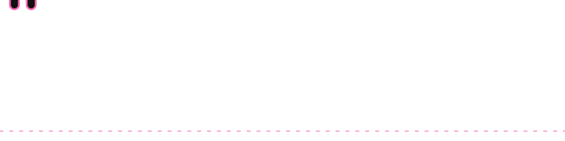
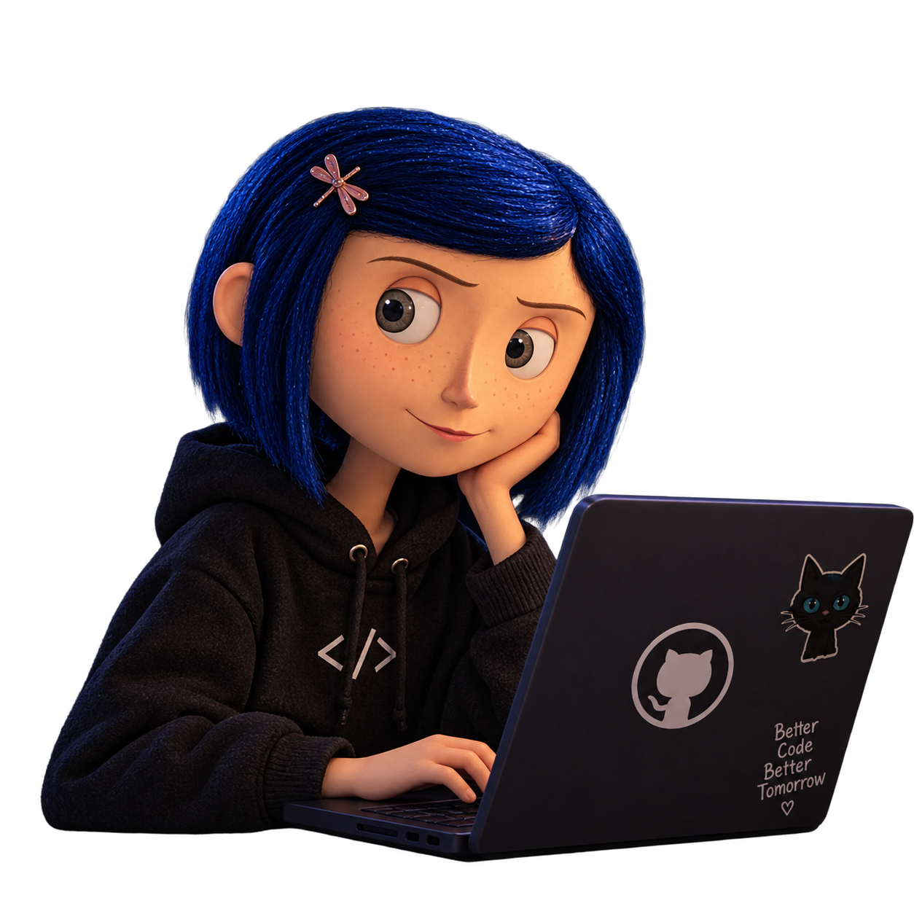

<table border="0">
<tr>
<td width="45%" align="center" valign="bottom">
  
</td>
<td width="55%" valign="middle">

### Sobre mim
Sou estudante de **Engenharia de Software** no Centro Universitário FAMA, no 3º semestre (2025–2029).

Gosto de entender como as coisas realmente funcionam.
🪡 Aprendendo: **C, estruturas de dados e Python**  
🐈‍⬛ Sempre com um projeto novo na cabeça

</td>
</tr>
</table>

---

🪡 <b>O que estou estudando</b> (clique para abrir)

 

-  Linguagem C e estruturas de dados (BST, AVL)
-  Python
-  Estruturas de dados e lógica de programação
-  Desenvolvimento de projetos pessoais e estudo contínuo

🧵 <b>Meus projetos</b> (clique para abrir)

 

-  **Você Cairia Nessa?**: simulador de golpes digitais (Projeto Integrador, FAMA)
-  **Ranking de jogadores**: implementação em C
